# Quick Access

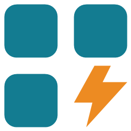

Quick Access adds a floating button to Home Assistant. Tap it on any page to open your shortcuts, or to look up entities and devices without leaving the page.

  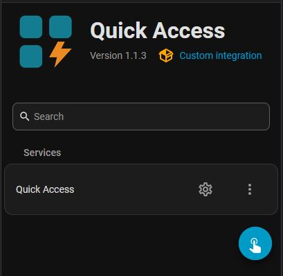
  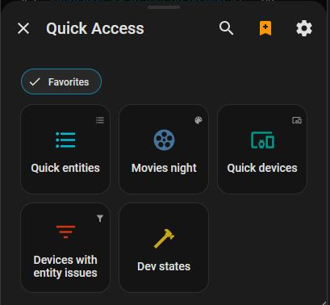
  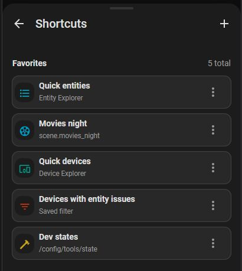

- **Shortcuts:** open dashboards, Home Assistant pages, external URLs, saved filters, or activate scenes.
- **Explorers:** search entities and devices, check their state and attributes, and find problems like unavailable entities or low batteries.
- **Your layout:** arrange shortcuts in groups, keep separate profiles, and choose which pages show the button.

> **Note:** The explorers only show information. They don't control devices. Use the info icon in entity details to open Home Assistant's **More Info** dialog, or the info icon in device details to open the Home Assistant device page.

## Install

**Requires Home Assistant Core 2025.9.0 or newer.**

1. In **HACS**, search for **Quick Access** and select **Download**.
2. Restart Home Assistant.
3. Go to **Settings -> Devices & services -> Add integration**, search for **Quick Access**, and add it.
4. Refresh your browser or Companion app.

Install without HACS

1. Download the [latest release](https://github.com/iva-stolnik/ha-quick-access/releases/latest).
2. Copy its `custom_components/quick_access` folder to `config/custom_components/quick_access/` in Home Assistant.
3. Restart Home Assistant.
4. Open **Settings -> Devices & services -> Add integration**, search for **Quick Access**, and add it.
5. Refresh your browser or Companion app.

## Quick start

### 1. Floating button

After installation, select the floating **Set up Quick Access** button in the corner of the page. Select **Start with defaults** to create your first profile with Entity Explorer and Device Explorer shortcuts, or select **+** to create a new profile. If you already have profiles, select **Use** beside a profile to use it in this browser.

If the button is hidden, open **Quick Access** in the Home Assistant sidebar and turn on **Show floating launcher**. The sidebar also lets you select an existing profile.

- **Move it:** press and hold, then drag.
- **Button menu:** press and hold without dragging to get **Reset position** and **Reload page**.

  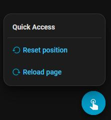

### 2. Open the launcher

Tap the button to open the launcher. Tap a shortcut to use it.

In the top bar:

- **Search icon:** searches your shortcuts.
- **Bookmark icon:** saves the page you're on as a shortcut.
- **Gear icon:** opens Settings.

### 3. Customize it

In **Settings**, switch profiles and manage **Shortcuts**, **Groups**, and **Display rules**.

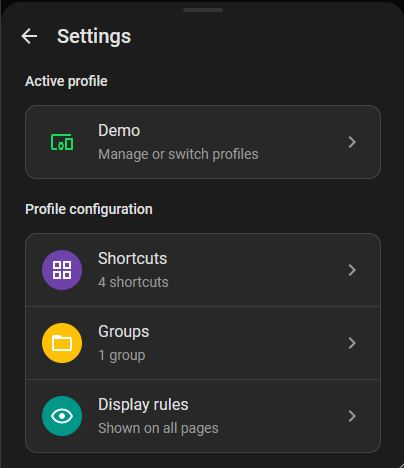

That's all you need to get started. The sections below cover each feature in more detail.

## Shortcuts

Go to **Settings -> Shortcuts** and select **+**. Give the shortcut a name, icon, and color, choose a group, and pick its type:

| Type | Opens |
|---|---|
| **Home Assistant path** | A dashboard or another Home Assistant page, for example `/config/tools/state`. |
| **Entity** / **Device Explorer** | The entity or device explorer. |
| **Saved filter** | An explorer with one of your saved filters applied. |
| **Scene** | Activates a scene. |
| **External URL** | An external web page. |

To add the page you're on with one tap, use the bookmark icon in the launcher.

  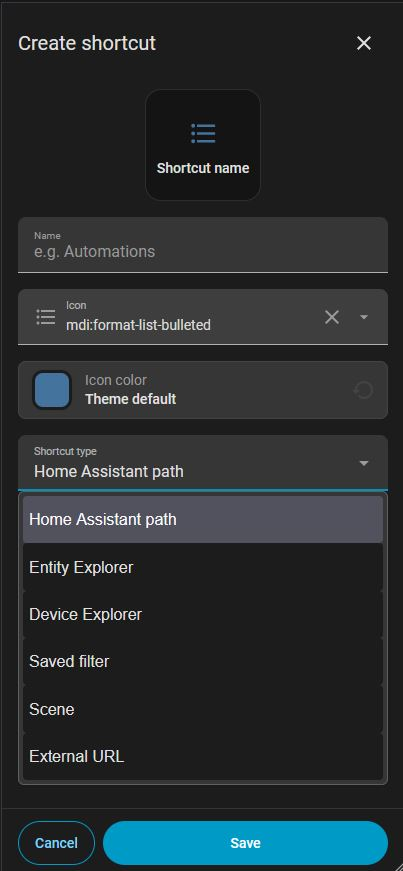

## Groups and layout

Go to **Settings -> Groups** and select a group. Set the number of columns and rows, and choose whether to show shortcut names.

Under **Arrange shortcuts**, press and hold a shortcut to drag it to a new spot. Select a shortcut to edit it, or select **Add** to create a new shortcut within the selected group. Save the group when you're done.

The built-in **Favorites** group can't be renamed. Other groups can.

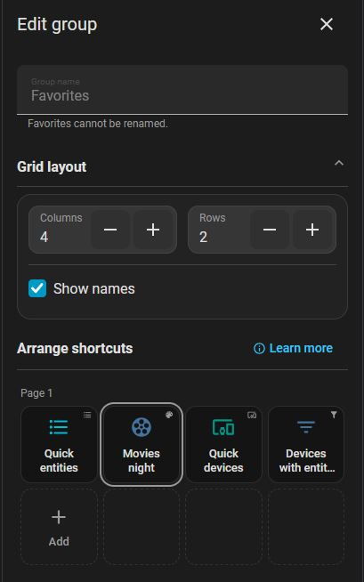
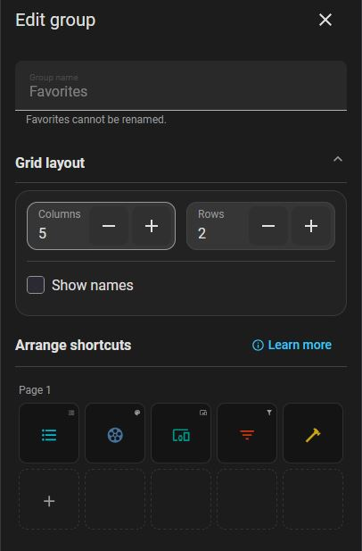

## Entity and Device Explorer

Open **Entity Explorer** or **Device Explorer** from the launcher. Search, select a filter to narrow the list, and star items to add them to your favorites.

- **Device Explorer:** expand a device's matching-entity count to see which of its entities match the filter.
- **Entity details:** see the current state, when it last changed, and its attributes. Copy the entity ID or attributes with one tap.

  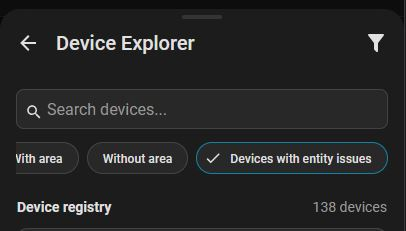
  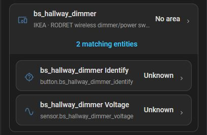
  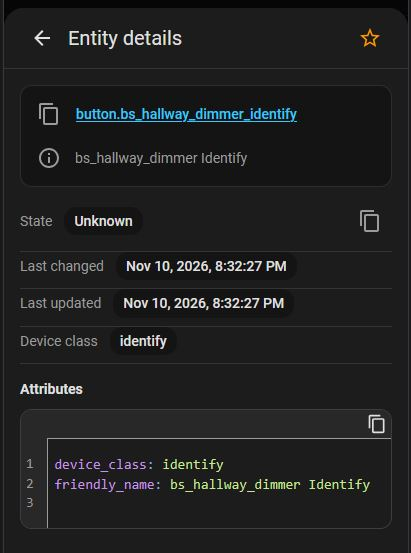

> **Warning:** On mobile, opening an entity's **More Info** dialog or a device page (info icon in details view) may take you away from the page you're on. If you're editing something, such as an automation, save it first.

### Filters

Select the filter icon in either explorer to use a preset, create your own filter, or edit one. Built-in presets cover:

- unavailable or unknown entities
- low batteries
- updates
- devices with or without an area
- devices with entity issues

You can apply a filter once or save it to your profile. To open a saved filter straight from the launcher, add it as a **Saved filter** shortcut.

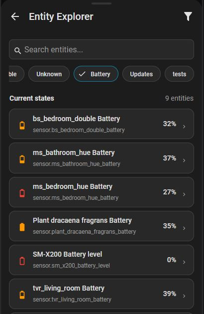
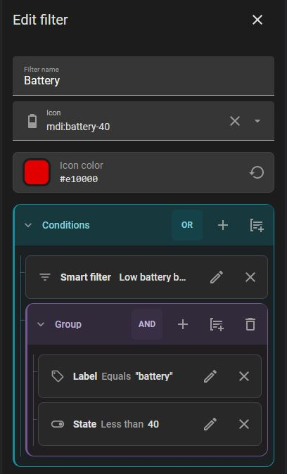

Custom filter conditions and examples

Custom filters can use conditions such as **area**, **label**, or **state**. Combine them with:

- **AND:** all conditions match.
- **OR:** at least one condition matches.
- **NONE:** no conditions match.
- **ANY / ALL:** for device filters that check their entities, whether at least one or all enabled entities with a state must meet the conditions. Devices without such entities don't match.

The **Low battery** condition uses a threshold, below **20%** by default. You can nest groups for more specific filters.

Examples:

1. **Unavailable entities:** open Entity Explorer and select **Unavailable**.
2. **Devices with entity issues:** open Device Explorer, select **Devices with entity issues**, then expand a device's matching-entity count.
3. **Items without labels:** create a filter with a **NONE** group that contains **Label -> Exists**. Entity filters also count labels inherited from the device.
4. **Battery checks:** add a **Low battery** condition below **20%**. Or combine groups: battery below 20%, OR the `battery` label with a state below 40.

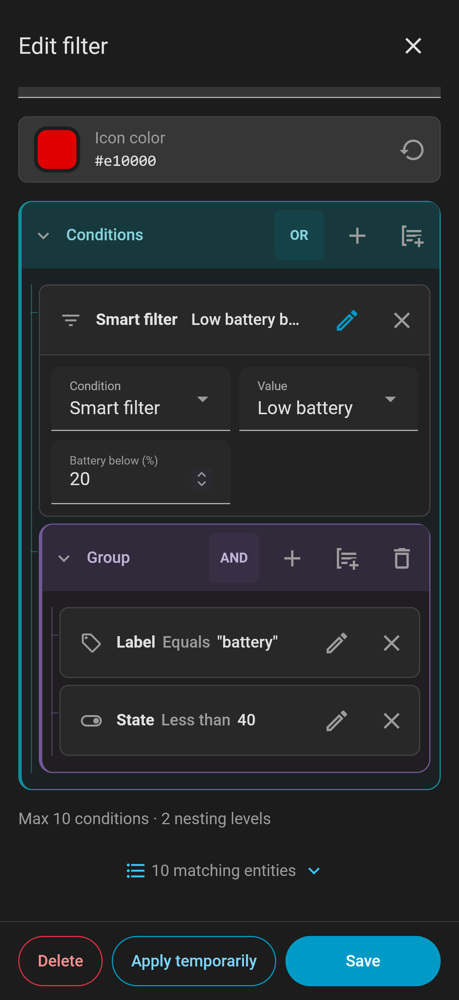

## Display rules

Choose which pages show the floating button. Go to **Settings -> Display rules** and pick a mode:

- **Show on all pages except those listed**
- **Show only on listed pages**

Then list page paths, one per line, each starting with `/`. For example, `/config/automation/*` matches all automation pages, and `/lovelace/cameras` matches that one page. Under **Current page**, select **Add** to insert the page you're on.

Display rules are saved in your profile.

  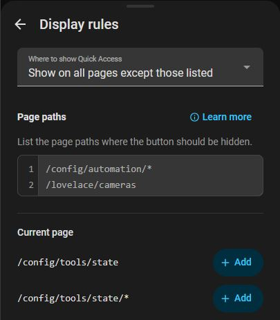

## Profiles

A profile holds your shortcuts, groups, filters, favorites, and display rules. Go to **Settings -> Active profile** to switch, create, rename, copy, or delete profiles.

Profiles are saved in Home Assistant for your user and sync between your devices.

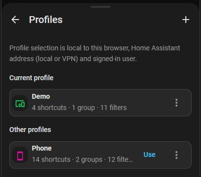

What's saved per browser

These stay in each browser, for each Home Assistant address:

- the active profile
- the button position and the **Show floating launcher** setting
- recent searches

If you open the same Home Assistant through different addresses (for example a local address and a Nabu Casa address), choose the profile at each one. Clearing browser data resets these settings but doesn't delete your profiles.

## Keyboard

With the floating button focused, press **Shift+Enter** or **Shift+Space** to open the button menu. Choose **Move button** to move it with the arrow keys, then press **Enter** to save or **Escape** to cancel.

## Where settings live

- **Launcher gear icon:** shortcuts, groups, profiles, and display rules.
- **Quick Access in the sidebar** (`/quick-access-config`): the active profile for this browser, button visibility, and recovery if the button is hidden.
- **Settings -> Devices & services -> Quick Access -> Configure** (administrators only): limits on profiles, groups, and storage for all users.

## Troubleshooting

- **Button not visible:** open **Quick Access** in the sidebar or go to `/quick-access-config`. Turn on **Show floating launcher**, select a profile, or reset display rules.
- **Button in the wrong place:** press and hold it and choose **Reset position**.
- **Frontend missing:** restart Home Assistant and refresh your browser or Companion app.
- **Profiles not saving:** check your connection to Home Assistant and try again.

For other problems, [open an issue](https://github.com/iva-stolnik/ha-quick-access/issues). Include your Home Assistant version, your browser or Companion app version, and the steps to reproduce.

## Removal

Remove Quick Access in **Settings -> Devices & services**. If you installed it with HACS, remove it from HACS too, then restart Home Assistant.

Removing the integration doesn't delete your saved profiles or browser settings. They may come back if you reinstall.

## Changelog and license

See the [changelog](https://github.com/iva-stolnik/ha-quick-access/blob/main/CHANGELOG.md). Licensed under [MIT](https://github.com/iva-stolnik/ha-quick-access/blob/main/LICENSE).
