# Quick Access

<a href="custom_components/quick_access/brand/icon.png">
  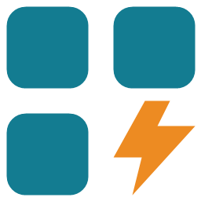
</a>

Quick Access adds a floating launcher to Home Assistant. Open **dashboards**, **external URLs**, **entities**, **devices** and saved **filters** or activate **scenes** from anywhere in Home Assistant. It follows your Home Assistant theme, and doesn't use dashboard cards or YAML.

  <a href="docs/images/launcher-closed.png">
    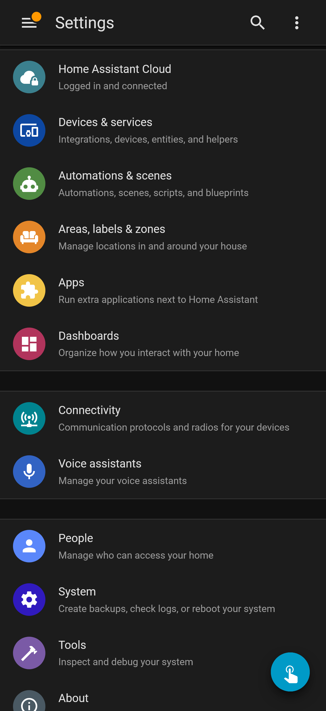
  </a>
  <a href="docs/images/launcher.png">
    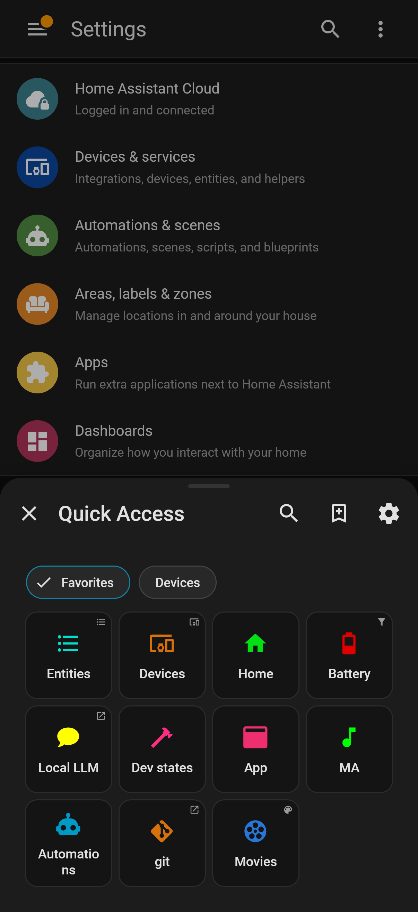
  </a>
  <a href="docs/images/floating-menu.png">
    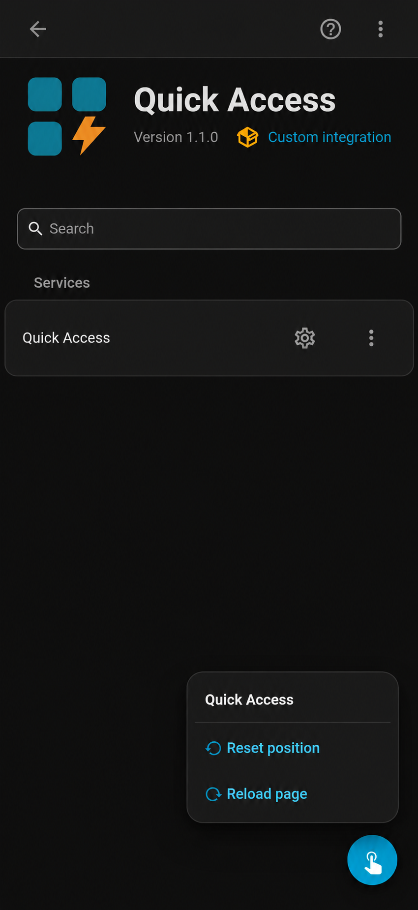
  </a>

**Requires Home Assistant Core 2025.9.0 or newer.**

## Features

### Floating button

- Open dashboards, Home Assistant pages, external URLs, saved entity or device filters and activate scenes.
- Quickly inspect entity and device details, including states and attributes, without leaving the current page.
- Organize shortcuts into groups with custom icons, colors and adjustable grids.
- Move the floating button and choose which pages show the launcher using visibility rules.

### Entity and Device Explorer

Search entities and devices, star favorites, and inspect entity or device details with live entity states and relevant attributes. Device filters can show their matching entities.

The explorers are read-only. They do not replace Home Assistant's controls: open the entity's **More Info** dialog or the Home Assistant device page to take action.

> [!WARNING]
> Opening an entity's `More Info` dialog on mobile, or navigating to a device page, may take you away from your current page. If you're editing an automation, save your changes first to avoid losing unsaved work.

Entity Explorer and Device Explorer with matching entities:

  <a href="docs/images/entity-explorer.png">
    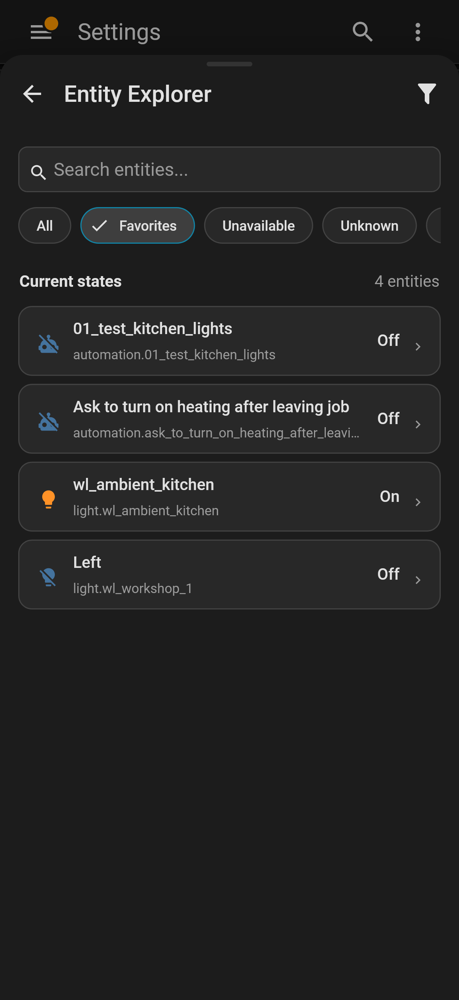
  </a>
  <a href="docs/images/entity-details.png">
    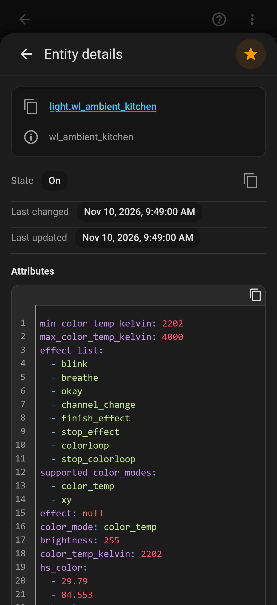
  </a>
  <a href="docs/images/device-explorer.png">
    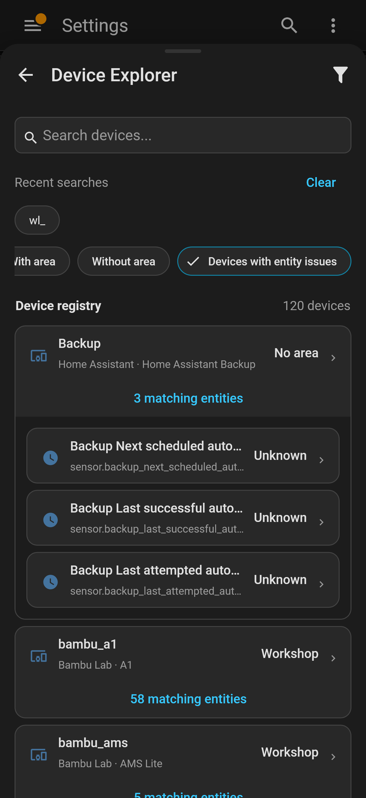
  </a>

### Smart and custom filters

- Start with built-in presets for unavailable or unknown entities, low batteries, updates, devices with or without an area, and devices with entity issues.
- Create custom entity and device filters using conditions such as area, label or state.
- Combine conditions with **AND** (all match), **OR** (at least one matches) or **NONE** (none match).
- Filter devices based on their entities, with **ANY** or **ALL** matching conditions.
- Set a **Low battery** percentage threshold for entity filters or device entity conditions; the default is below **20%**.
- Save filters and add them as launcher shortcuts. See [Filters](#filters) for practical examples.

### Profiles and personalization

A profile is a collection of your shortcuts, groups, filters and preferences. You can create different profiles for different setups.

Create, rename, copy or delete profiles and customize each profile's shortcuts, groups, filters, favorites and visibility settings. Profiles belong to your Home Assistant user, and their contents sync through Home Assistant. Each browser uses its own active profile; see [Profiles and synchronization](#profiles-and-synchronization).

## Installation

### HACS

Quick Access is not in the default HACS catalog yet, so add it as a custom repository:

1. In **HACS → ⋮ → Custom repositories**, add `https://github.com/iva-stolnik/ha-quick-access` and select **Integration**, or use the button above to open the repository in HACS.
2. Find **Quick Access** and download it.
3. Restart Home Assistant.
4. Go to **Settings → Devices & services → Add integration** and add **Quick Access**.
5. Refresh your browser or Companion app.

### Manual

1. Download the [latest release](https://github.com/iva-stolnik/ha-quick-access/releases/latest) and copy its `custom_components/quick_access` folder into your Home Assistant `config/custom_components/` directory. The integration files must be inside `config/custom_components/quick_access/`.
2. Restart Home Assistant.
3. Add **Quick Access** under **Settings → Devices & services → Add integration**.
4. Refresh your browser or Companion app.

## Quick Start

1. Install Quick Access and add the integration using the steps above.
2. Tap **Set up Quick Access**. You can also open **Quick Access** in the Home Assistant sidebar.
3. Create or select a profile.
4. Tap the floating button to open the launcher.
5. Open its settings using the gear icon, go to **Shortcuts → Add shortcut**, and add a dashboard, scene or other shortcut.
6. Optionally open **Entity Explorer** or **Device Explorer**, try a preset, and save a custom filter for later.

## How to configure Quick Access
Quick Access provides different settings depending on what you want to change:
- **Floating launcher**: Open shortcuts, explorers and saved filters. Use the gear icon to manage profiles, shortcuts, groups and display rules.

- **Quick Access sidebar page**: Select the active profile for this browser, enable or disable the floating launcher, or reset display rules if the launcher becomes hidden. You can also open it at `/quick-access-config`.

- **Integration settings** (administrators): Go to Settings → Devices & services → Quick Access → Configure to manage resource limits for profiles, groups and storage across users.

## Usage

### Shortcuts

To save the Home Assistant page you are viewing, tap the launcher's bookmark-plus icon (save current page). Use settings (the gear icon) to manage shortcuts, groups, the grid and visibility rules.

### Filters

Use the filter icon in device or entity explorer to create or edit filters. Try these examples:

1. **Find unavailable entities:** open Entity Explorer and select **Unavailable**.
2. **Find devices with unavailable or unknown entities:** open Device Explorer and select **Devices with entity issues**. Expand a device's matching-entity count to see which entities need attention.
3. **Find entities or devices without labels:** create a filter in the relevant explorer, add a **NONE** group, and put a **Label → Exists** condition inside it. Entity filters also consider labels inherited from the device.

To reopen a saved filter directly, add a shortcut with the **Saved filter** type, then choose the entity or device filter you saved.

### Launcher controls

Press and hold the floating button, then drag it to reposition it. 

To open the button menu, press and hold without dragging. From there, you can:
 - **Reset position** → restore the floating button to its default position.
 - **Reload page** → refresh the current Home Assistant page. This can help when a kiosk display stops updating.

**Keyboard controls**: Press **Shift+Enter** or **Shift+Space** to open the menu. This also reveals the **Move button** option, which is hidden for touch and pointer interactions.

Select **Move button**, use the arrow keys to reposition it, then press Enter to save or Escape to cancel.

## Profiles and synchronization

Select the same profile on each device to share its shortcuts, filters, favorites and visibility settings. Changes are saved in Home Assistant for your signed-in user and sync to all devices using that profile.

The **active profile selection is local to each browser and Home Assistant address**. When using both local and remote URLs (eg. Nabu Casa cloud/link), you need to select your profile for each address.

Button position, the **Show floating launcher** toggle and recent searches also stay local to each browser and address. Clearing browser data removes these local preferences but keeps your saved profiles in Home Assistant.

## More screenshots and usage examples

View additional screenshots and usage

### Creating shortcuts

Open the launcher's settings (the gear icon), select **Shortcuts**, then **Add shortcut**. Choose a name, icon and color, and use the preview to see how the shortcut will look in the launcher.

Under **Shortcut type**, choose **Home Assistant path** to open a dashboard or another Home Assistant page. Enter its path, such as `/config/tools/state`, or select **Add** under **Use current page path** to fill in the page you are viewing. Other types open **Entity Explorer**, **Device Explorer**, a **Saved filter** or an **External URL**, or activate a **Scene**. Choose the filter or scene, or enter the external URL, as appropriate. Select a **Group**, then **Save** to add the shortcut to your profile.

  <a href="docs/images/create-shortcut.png">
    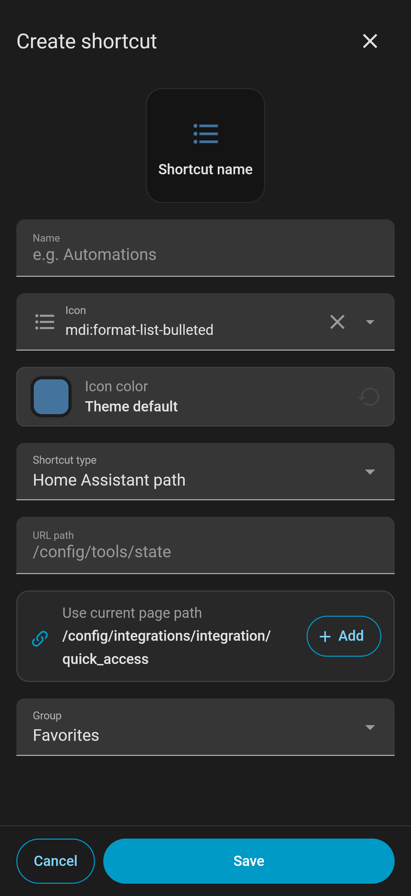
  </a>
  <a href="docs/images/shortcut-types.JPG">
    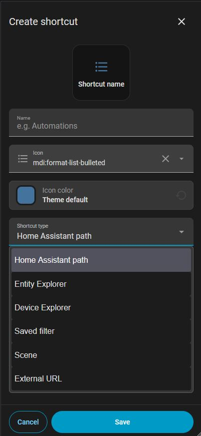
  </a>

### Editing groups

Open the launcher's settings (the gear icon), select **Groups**, then select a group to edit it. Rename custom groups, adjust the number of columns and rows under **Grid layout**, and choose whether to **Show names**. The built-in **Favorites** group cannot be renamed.

Under **Arrange shortcuts**, press and hold a shortcut to drag it into a new position. Tap a shortcut to edit it, or use **Add** to create one in the group. Select **Save** to apply the group's layout and order.

<a href="docs/images/edit-group.png">
  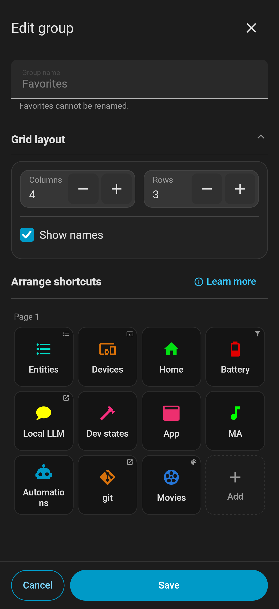
</a>

### Display rules

Open the launcher's settings (the gear icon) and select **Display rules** to choose where the floating button appears. Choose **Show on all pages except those listed** to hide it on selected pages, or **Show only on listed pages** to limit it to selected pages.

Enter one page path per line, starting with `/`. In the example below, `/config/automation/*` hides the button on all automation subpages, while `/lovelace/cameras` hides it on that exact page. Use the **Add** buttons under **Current page** to add the current path or its subpage wildcard, then select **Save**. Display rules belong to the selected profile and sync to devices using it.

<a href="docs/images/display-rules.png">
  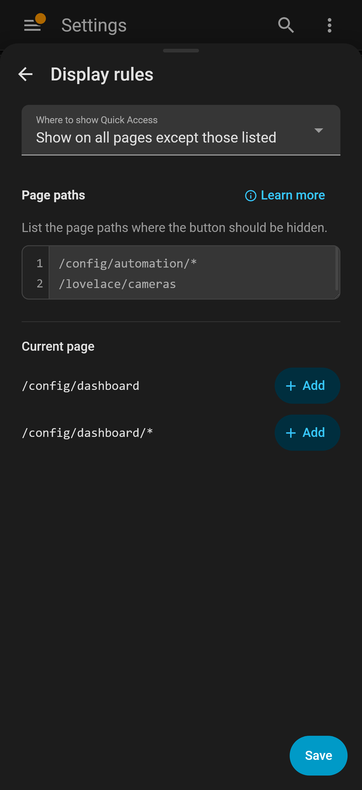
</a>

### Custom filters

Open **Entity Explorer** or **Device Explorer** and use the filter icon to create or edit a filter. Choose a name, icon and color, then add conditions such as area, label, state or **Low battery**. Combine conditions with **AND** (all match), **OR** (at least one matches) or **NONE** (none match), and nest groups for more specific rules.

The example below matches entities with a battery below **20%**, or entities that have the **battery** label and a state below **40**. Expand the matching-entity count to preview the results, then select **Save** to keep the filter in your profile or **Apply temporarily** to use it without saving. To open a saved filter from the launcher, add a shortcut with the **Saved filter** type.

<a href="docs/images/edit-filter.png">
  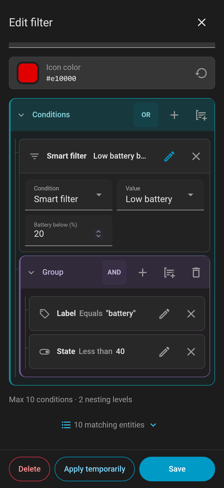
</a>

## Troubleshooting

- **Button missing?** Open **Quick Access** in the sidebar or visit `/quick-access-config`. Enable **Show floating launcher**, select a profile or reset its visibility rules.
- **Frontend missing after installation?** Refresh your browser or Companion app after restarting Home Assistant and adding the integration.
- **Profiles won't load or save?** Check your Home Assistant connection and retry after reconnecting.
- **Something else?** [Open an issue](https://github.com/iva-stolnik/ha-quick-access/issues) with your Home Assistant version, browser or Companion app version, and steps to reproduce.

## Removal

Delete Quick Access under **Settings → Devices & services**. If installed through HACS, remove it there too and restart Home Assistant.

Removing the integration does not delete saved profiles or browser preferences. This allows your configuration to be restored if you reinstall Quick Access.

## Changelog and license

See the [Changelog](CHANGELOG.md) for release notes. Licensed under [MIT](LICENSE).
